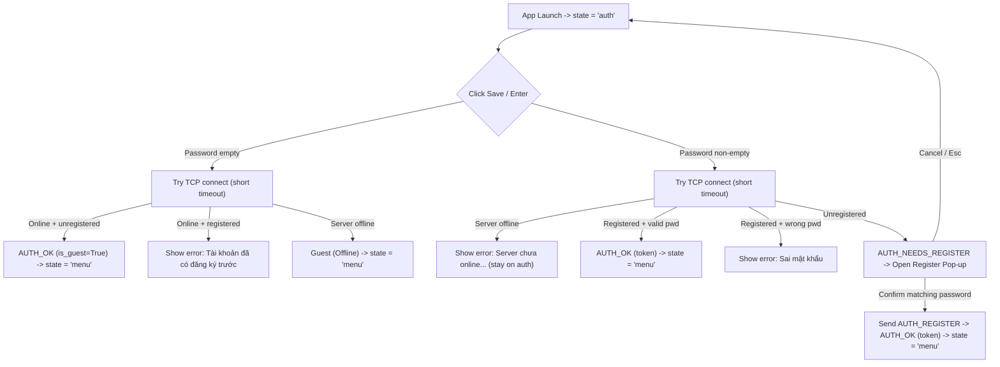

# Login / Register & Guest Identity Design

**Date:** 2026-11-27
**Project:** Pixel Chess (`E:\chess_game`)
**Status:** Draft (pending builder check and user approval)

## 1. Intent and Why

Pixel Chess currently has no player identity system: the menu goes straight to **Play vs Bot** or **Play Online**, [client/gui/hud.py](file:///E:/chess_game/client/gui/hud.py) hardcodes `"You"` and `"Opponent"`, and [server/rooms.py](file:///E:/chess_game/server/rooms.py) tracks rooms purely by transient `conn_id` in RAM.

The goal is to let players identify themselves right upon opening the game—supporting both frictionless **Guest** play (including offline **Play vs Bot** when the server is not running) and lightweight **Register / Login** accounts—so player names appear in both AI and Online matches and registered usernames cannot be impersonated by Guests.

## 2. Goals, Non-Goals, and Anti-Goals

### Goals
- Show an account entry screen (`auth`) immediately on app launch, before the main menu (`Play vs Bot` / `Play Online`).
- Support one unified form (`Username`, `Password`, `Save`) with three outcomes:
  1. **Guest (empty `Password`):**
     - If server is reachable: check whether `Username` is already registered. If unregistered, allow entry as Guest; if registered, block with `"Tài khoản đã có đăng ký trước"`.
     - If server is offline: allow entry as `Guest (Offline)` so the player can still play **Play vs Bot**; re-verify the Guest name with the server when they later enter **Play Online**.
  2. **Login (non-empty `Password`, `Username` already registered):**
     - Do **not** show any confirmation pop-up. Verify password on server; on success log in and go to main menu; on failure show error.
  3. **Register (non-empty `Password`, `Username` not yet registered):**
     - Show a modal pop-up (*"Bạn muốn đăng ký tài khoản?"*) with a masked `Password Confirm` input and Confirm / Cancel buttons.
     - If passwords match and user confirms, create the account on the server and log in immediately.
- Display the current player identity on the main menu with a **Switch Account / Logout** button.
- Display real player names in [client/gui/hud.py](file:///E:/chess_game/client/gui/hud.py) for both **Play vs Bot** and **Play Online**.

### Non-Goals
- No Elo rating, match history, leaderboard, profile stats, avatars, email verification, or password recovery.
- No blocking **Play vs Bot** behind a running server for Guest users.
- No auto-login / persisted credentials file on client disk in this iteration (session lives in memory per app run).

### Anti-Goals
- **No silent downgrade on password submit:** If the user fills `Password` and clicks `Save` while the server is offline, never silently log them in as an offline Guest—show a clear error so they never mistakenly think their account was registered or authenticated.
- **No plaintext passwords on disk** on either server or client.
- **No blocking the 60 FPS pygame loop** with indefinite socket waits.

## 3. Constraints

- **Dependencies:** Use only existing dependencies (`pygame-ce`, `python-chess`) and Python standard library (`sqlite3`, `hashlib`, `hmac`, `secrets`, `socket`, `threading`). Do not add packages to `requirements.txt`.
- **Protocol:** Extend existing length-prefixed JSON framing (`!I` + UTF-8 JSON, `MAX_FRAME = 65536`) in [shared/protocol.py](file:///E:/chess_game/shared/protocol.py).
- **Codebase boundaries (`AGENTS.md`):** Respect module separation between UI (`client/gui/*`, `client/input/*`, `client/main.py`) and backend/network/game logic (`server/*`, `shared/*`, `client/game/*`, `client/ai/*`). Keep `client/gui/hud.py` backwards-compatible for any callers passing default arguments.

## 4. Approaches Considered

1. **Approach A — SQLite on TCP Server + Extended TCP Protocol *(Chosen)***
   - Server stores accounts in SQLite (`sqlite3`) with salted password hashes (`hashlib.pbkdf2_hmac` / `scrypt`) and exposes auth messages over the existing TCP server on port `8765`.
   - **Tradeoffs:** Single server process/port, zero new dependencies, atomic uniqueness constraints via SQLite, clean foundation if stats/Elo are added later. Requires clean client socket lifecycle handling between auth check and online room play.
2. **Approach B — JSON Flat-File Store on TCP Server *(Rejected)***
   - **Tradeoffs:** Human-readable file, but requires manual atomic file writes to prevent corruption and handles concurrent writes poorly compared to SQLite.
3. **Approach C — Separate HTTP Auth Server *(Rejected)***
   - **Tradeoffs:** Decouples auth from TCP game server, but forces running and managing two servers/ports for a small desktop app.

## 5. Detailed Design

### 5.1. Validation & Identity Rules (Design Calls)
- **Username normalization & format:** Trim leading/trailing whitespace (`strip()`). Require 3–20 characters matching `^[A-Za-z0-9_.-]+$` (safe single-line rendering in `Chess-Sans.ttf` and clean HUD layout). Uniqueness is **case-insensitive** (stored via normalized `username_lower = username.lower()`), while preserving the user's original casing as `display_name`.
- **Password format:** Minimum 4 characters (not stripped); compared using `hmac.compare_digest`.
- **Guest uniqueness online:** Concurrent online Guests are tracked by `conn_id` and may use any unregistered username (even if another active Guest picked the same display name), avoiding ephemeral Guest-name squatting. Only registered accounts reserve a username.
- **Database location:** `server/data/chess.db` by default (auto-create parent directory; ignore `server/data/*.db` in `.gitignore`), injected via parameter so unit tests can use `:memory:` or a temporary path.

### 5.2. Server Storage & Auth Module (`server/auth.py`)
- SQLite table `users`:
  ```sql
  CREATE TABLE IF NOT EXISTS users (
      id INTEGER PRIMARY KEY AUTOINCREMENT,
      username_lower TEXT NOT NULL UNIQUE,
      display_name TEXT NOT NULL,
      password_salt TEXT NOT NULL,
      password_hash TEXT NOT NULL,
      created_at REAL NOT NULL
  );
  ```
- Password hashing: 16-byte `secrets.token_hex(16)` salt + `hashlib.pbkdf2_hmac('sha256', password.encode('utf-8'), salt_bytes, 200_000).hex()`.
- In-memory session tokens on the server (`token -> display_name`) issued on successful Login or Register so the client can re-authenticate on a fresh TCP connection when entering **Play Online** or starting a second online match without re-typing the password.
- Methods on `UserStore` / `AuthService` (protected by `threading.RLock` or per-call connection/lock):
  - `check_guest(username) -> ok | already_registered | invalid_username`
  - `submit_login_or_probe(username, password) -> ok(token, display_name) | needs_register(display_name) | invalid_credentials | invalid_input`
  - `register(username, password) -> ok(token, display_name) | already_registered | invalid_input`
  - `verify_token(token) -> display_name | None`

### 5.3. Shared Protocol Extensions (`shared/protocol.py`)
Add `MessageType` entries:
- Client → Server:
  - `AUTH_GUEST`: `{'username': str}`
  - `AUTH_SUBMIT`: `{'username': str, 'password': str}` (used when `Save` is clicked with a non-empty password)
  - `AUTH_REGISTER`: `{'username': str, 'password': str}` (sent after user confirms pop-up with matching `Password Confirm`)
  - `AUTH_TOKEN`: `{'token': str}` (used when opening a room connection after prior Login/Register)
- Server → Client:
  - `AUTH_OK`: `{'username': str, 'is_guest': bool, 'token': str | None}`
  - `AUTH_NEEDS_REGISTER`: `{'username': str}`
  - `AUTH_ERROR`: `{'reason': str}` — e.g. `'username_registered'`, `'invalid_credentials'`, `'invalid_username'`, `'invalid_password'`, `'invalid_token'`
- Room/Match payload updates:
  - `GAME_START` in [server/rooms.py](file:///E:/chess_game/server/rooms.py) adds `'white_name': str` and `'black_name': str` (falling back to `'White'` / `'Black'` only if a legacy unauthenticated connection ever existed, though authenticated `RoomManager` can require auth or default cleanly).

### 5.4. Server Room Integration (`server/rooms.py` & `server/main.py`)
- `RoomManager` accepts an optional `auth_service` (defaulting to a `UserStore` instance if not injected, keeping existing unit tests that instantiate `RoomManager()` working without breaking unauthenticated tests unless desired — **important:** check existing server tests during planning so existing `CREATE_ROOM`/`JOIN_ROOM` tests remain green or are updated intentionally).
- `RoomManager` tracks `_conn_to_user: dict[str, dict]` (`{'username': str, 'is_guest': bool}`).
- When handling `AUTH_GUEST`, `AUTH_SUBMIT`, `AUTH_REGISTER`, `AUTH_TOKEN`, `RoomManager` delegates to `auth_service`, stores `_conn_to_user[conn_id]` on `AUTH_OK`, and returns the response frame.
- On `on_disconnect(conn_id)`, clean up `_conn_to_user.pop(conn_id, None)`.
- On `JOIN_ROOM`, populate `white_name` and `black_name` in `GAME_START` from `_conn_to_user` (defaulting to `'White'` / `'Black'` if connection did not send auth).

### 5.5. Client Flow, UI & Networking (`client/main.py`, `client/net/tcp_client.py`, `client/gui/hud.py`)

#### Client Session State
Track `auth_session` in `client/main.py`:
- `None` when not yet saved (`state = 'auth'`).
- `{'username': str, 'is_guest': bool, 'token': str | None, 'offline_guest': bool}` once saved.

#### State Machine & Auth Flow


#### Non-blocking Auth Requests in Pygame
- Add an optional `timeout` parameter to `TCPClient.__init__(host, port=DEFAULT_TCP_PORT, timeout=None)` (default `None` to preserve existing behavior, e.g. `1.5s` for auth connect, then reset socket timeout to `None` before starting the receiver thread).
- Show a brief `"Đang kiểm tra..."` state while awaiting the server response (`poll_messages()`) in the 60 FPS loop so the UI stays responsive, and transition on `AUTH_OK` / `AUTH_NEEDS_REGISTER` / `AUTH_ERROR`. Close the temporary auth TCP socket once `auth` succeeds (keeping `auth_session` in memory) so **Play vs Bot** does not hold an idle socket open.

#### Entering Play Online from Menu
- When user clicks **Create Room** or **Join Room** (or when clicking **Play Online** from `menu`):
  - Re-authenticate on the new `TCPClient` before sending `CREATE_ROOM` / `JOIN_ROOM`:
    - If `auth_session['token']` exists: send `AUTH_TOKEN`, wait for `AUTH_OK` before `CREATE_ROOM` / `JOIN_ROOM`. If `AUTH_ERROR` (`invalid_token`, e.g., server restarted), clear session and return to `auth` with an informative message.
    - If `auth_session['is_guest']`: send `AUTH_GUEST` (`username`). If server now reports `'username_registered'` (e.g., user was `Guest (Offline)` or someone registered that name meanwhile), return to `auth` with `"Tài khoản đã có đăng ký trước"`.
  - Doing this check right when clicking **Play Online** (or cleanly queueing the room action after `AUTH_OK`) catches offline-guest conflicts before the user enters room creation/join.

#### UI Layout (`client/main.py` & `client/gui/hud.py`)
- **`auth` screen:**
  - Centered title `'Pixel Chess'`
  - `Username` input box (active by default)
  - `Password` input box (masked `*`, helper label: `"Mật khẩu (để trống để chơi Guest)"`)
  - `Save` button (click or `Enter` submits; `Tab` toggles active input)
  - Error label below
- **Register Pop-up (modal overlay on `auth`):**
  - Semi-transparent dark overlay over `auth`
  - Card showing `"Bạn muốn đăng ký tài khoản '<username>'?"`
  - Masked `Password Confirm` input box (auto-focused)
  - Validation error line inside modal if confirm does not match `Password`
  - `Confirm` (`Đăng ký`) and `Cancel` (`Hủy`) buttons (`Enter` confirms, `Esc` cancels)
- **`menu` screen:**
  - Top/header line showing current identity (`<username>` / `<username> (Guest)` / `<username> (Guest - Offline)`) + `Switch Account` (`Đổi tài khoản`) button that clears `auth_session` and returns to `auth`.
- **HUD (`client/gui/hud.py`):**
  - Update `draw_players(screen, game, pieces, font, small, clock_font, difficulty, stopped=False, player_name='You', opponent_name='Opponent')` to render `player_name` and `opponent_name` (truncated cleanly if needed).
  - In `Play vs Bot`: `player_name = auth_session['username']`, `opponent_name = 'Bot'`.
  - In `Play Online`: `player_name` = local player's name, `opponent_name` = opponent's name from `GAME_START` (`white_name` / `black_name`).

## 6. Left to the Builder / Implementation Plan

- Exact pixel coordinates, colors, and Vietnamese/English label consistency matching existing buttons in [client/main.py](file:///E:/chess_game/client/main.py).
- Updating `.gitignore` for `server/data/*.db` (if not already ignored).
- Checking whether `tests/` already exists in the repo and organizing unit + integration tests for `UserStore`, `RoomManager` auth routing, `GAME_START` player names, `TCPClient` timeout, and `draw_players`.
